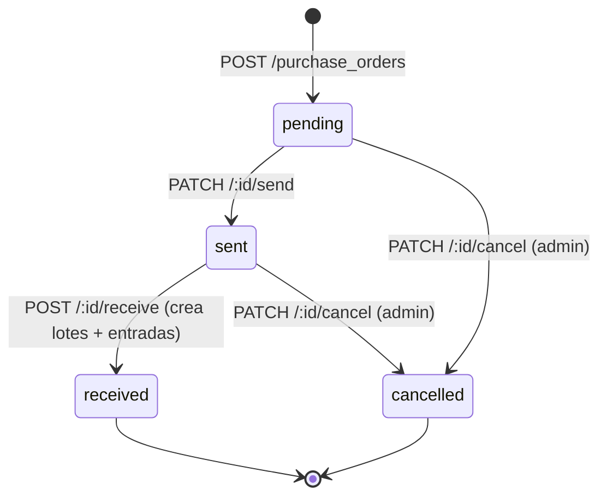

# Órdenes de compra

[← Volver al índice](README.md)

## Ciclo de vida



Cualquier otra transición responde `422` con `code: "invalid_transition"`.

## Campos de una orden

| Campo | Tipo | Significado |
|---|---|---|
| `id` | entero | Número de orden |
| `status` | string | `pending`, `sent`, `received`, `cancelled` |
| `notes` | string o `null` | Notas |
| `total_amount` | número | Suma de `quantity × unit_price` de los ítems (calculado por el servidor) |
| `items_count` | entero | Cantidad de ítems |
| `supplier` | objeto | `id`, `company_name` |
| `created_at`, `updated_at` | timestamp | Alta y último cambio |
| `items` | arreglo | Solo en detalle y en respuestas de acciones |
| `items[].id` | entero | Id del ítem (se usa en la recepción) |
| `items[].product` | objeto | `id`, `name`, `presentation` |
| `items[].quantity` | entero | Unidades pedidas |
| `items[].unit_price` | número o `null` | Precio unitario |
| `items[].subtotal` | número | `quantity × unit_price` |

---

## GET /purchase_orders

| | |
|---|---|
| Acceso | Protegida |
| Rol | cualquiera |

| Parámetro | Tipo | Valores | Descripción |
|---|---|---|---|
| `status` | string | `pending`, `sent`, `received`, `cancelled` | Filtra por estado. Otro valor → 422 |
| `supplier_id` | entero | — | Órdenes de un proveedor |
| `page`, `per_page` | entero | | Paginación |

Ordenado de la más nueva a la más vieja. Cada elemento sin `items`.

```bash
curl -s "http://localhost:3000/api/v1/purchase_orders?status=sent&per_page=2" -H "Authorization: Bearer $TOKEN"
```

Errores: `401`, `422 invalid_params` (`"status": ["debe ser uno de: pending, sent, received, cancelled"]`).

---

## GET /purchase_orders/:id

Detalle con `items`. Errores: `401`, `404` (`"Orden de compra no encontrada"`).

---

## POST /purchase_orders

| | |
|---|---|
| Acceso | Protegida |
| Rol | cualquiera |
| Encabezados | `Authorization: Bearer <token>`, `Content-Type: application/json` |

La orden se crea en estado `pending`. El `total_amount` se calcula en el servidor (si el cliente lo envía, se ignora).

### Cuerpo

| Campo | Tipo | Obligatorio | Validaciones |
|---|---|---|---|
| `purchase_order.supplier_id` | entero | sí | Proveedor existente |
| `purchase_order.notes` | string | no | — |
| `purchase_order.items` | arreglo | sí | Al menos un ítem |
| `items[].product_id` | entero | sí | Producto existente |
| `items[].quantity` | entero | sí | Entero `> 0` |
| `items[].unit_price` | número | no | `≥ 0` |

```bash
curl -s -X POST http://localhost:3000/api/v1/purchase_orders \
  -H "Authorization: Bearer $TOKEN" -H "Content-Type: application/json" \
  -d '{"purchase_order":{"supplier_id":2,"notes":"Reposición semanal","items":[{"product_id":1,"quantity":24,"unit_price":1450.5}]}}'
```

`201 Created`:

```json
{
  "message": "Orden de compra creada",
  "data": {
    "id": 8,
    "status": "pending",
    "notes": "Reposición semanal",
    "total_amount": 34812.0,
    "items_count": 1,
    "supplier": { "id": 2, "company_name": "Distribuidora Pampa S.R.L." },
    "created_at": "2026-10-28T14:33:29Z",
    "updated_at": "2026-10-28T14:33:29Z",
    "items": [
      {
        "id": 11,
        "product": { "id": 1, "name": "Ibuprofeno 400 mg", "presentation": "Comprimidos x 20" },
        "quantity": 24,
        "unit_price": 1450.5,
        "subtotal": 34812.0
      }
    ]
  }
}
```

### Errores

| HTTP | `code` | Causa |
|---|---|---|
| 400 | `bad_request` | Falta el objeto `purchase_order` |
| 401 | `unauthorized` / `token_expired` | Sesión inválida o vencida |
| 422 | `validation_failed` | Sin proveedor, sin ítems, cantidad o precio inválidos |

```json
// items: []
{
  "error": {
    "code": "validation_failed",
    "message": "Los datos enviados no son válidos: Ítems debe tener al menos un ítem",
    "details": { "purchase_order_items": ["debe tener al menos un ítem"] }
  }
}
```

---

## PATCH /purchase_orders/:id/send

| | |
|---|---|
| Acceso | Protegida |
| Rol | cualquiera |
| Transición | `pending` → `sent` |

Sin cuerpo. `200 OK` con la orden actualizada:

```bash
curl -s -X PATCH http://localhost:3000/api/v1/purchase_orders/8/send -H "Authorization: Bearer $TOKEN"
```

```json
{
  "message": "Orden enviada al proveedor",
  "data": { "id": 8, "status": "sent", "total_amount": 34812.0, "…": "…", "items": ["…"] }
}
```

Errores: `401`, `404`, `422 invalid_transition`:

```json
{ "error": { "code": "invalid_transition", "message": "No se puede enviar una orden enviada", "details": null } }
```

---

## PATCH /purchase_orders/:id/cancel

| | |
|---|---|
| Acceso | Protegida |
| Rol | **admin** |
| Transición | `pending` o `sent` → `cancelled` |

Sin cuerpo. `200 OK` con `"message": "Orden cancelada"` y la orden con `status: "cancelled"`.

| HTTP | `code` | Causa |
|---|---|---|
| 401 | `unauthorized` / `token_expired` | Sesión inválida o vencida |
| 403 | `forbidden` | El usuario es `employee` |
| 404 | `not_found` | No existe la orden |
| 422 | `invalid_transition` | La orden ya fue recibida o cancelada |

```json
{ "error": { "code": "invalid_transition", "message": "No se puede cancelar una orden recibida", "details": null } }
```

---

## POST /purchase_orders/:id/receive

| | |
|---|---|
| Acceso | Protegida |
| Rol | cualquiera |
| Transición | `sent` → `received` |

Registra la llegada de la mercadería. En **una transacción**, por cada ítem:

1. Busca un lote del producto con ese `lot_number`; si no existe, lo crea (`status: active`).
2. Registra un `StockMovement` de tipo `entrada` por la cantidad pedida (motivo: `Recepción de orden de compra #<id>`), lo que suma el stock al lote.
3. Pasa la orden a `received`.

Si un dato es inválido no se crea ningún lote ni movimiento.

### Cuerpo

Hay que enviar los datos de **todos** los ítems de la orden.

| Campo | Tipo | Obligatorio | Validaciones |
|---|---|---|---|
| `purchase_order.items` | arreglo | sí | Un elemento por ítem de la orden |
| `items[].id` | entero | sí | Id del ítem (`items[].id` del detalle de la orden) |
| `items[].lot_number` | string | sí | No vacío |
| `items[].expiration_date` | fecha | sí | `AAAA-MM-DD`, posterior a hoy |
| `items[].location` | string | no | Ubicación del lote |

```bash
curl -s -X POST http://localhost:3000/api/v1/purchase_orders/8/receive \
  -H "Authorization: Bearer $TOKEN" -H "Content-Type: application/json" \
  -d '{"purchase_order":{"items":[{"id":11,"lot_number":"DEMO-1793198014","expiration_date":"2027-03-31","location":"Depósito"}]}}'
```

`200 OK`:

```json
{
  "message": "Orden recibida: se cargaron los lotes y el stock",
  "data": {
    "id": 8,
    "status": "received",
    "notes": "Reposición semanal",
    "total_amount": 34812.0,
    "items_count": 1,
    "supplier": { "id": 2, "company_name": "Distribuidora Pampa S.R.L." },
    "created_at": "2026-10-28T14:33:29Z",
    "updated_at": "2026-10-28T14:33:36Z",
    "items": [
      {
        "id": 11,
        "product": { "id": 1, "name": "Ibuprofeno 400 mg", "presentation": "Comprimidos x 20" },
        "quantity": 24,
        "unit_price": 1450.5,
        "subtotal": 34812.0
      }
    ]
  }
}
```

Después de la recepción, `GET /products/1` muestra el lote `DEMO-1793198014` con 24 unidades y el
`total_stock` del producto 24 unidades mayor.

### Errores

| HTTP | `code` | Causa |
|---|---|---|
| 400 | `bad_request` | Falta el objeto `purchase_order` |
| 401 | `unauthorized` / `token_expired` | Sesión inválida o vencida |
| 404 | `not_found` | No existe la orden |
| 422 | `invalid_transition` | La orden no está en `sent` |
| 422 | `validation_failed` | Falta un ítem, lote vacío o vencimiento inválido. `details` usa claves `items[<posición>].<campo>` |

```json
// lot_number vacío y vencimiento pasado
{
  "error": {
    "code": "validation_failed",
    "message": "Los datos enviados no son válidos: Ítem 1: número de lote es obligatorio y Ítem 1: vencimiento debe ser posterior a hoy",
    "details": {
      "items[0].lot_number": ["es obligatorio"],
      "items[0].expiration_date": ["debe ser posterior a hoy"]
    }
  }
}

// la orden todavía está pendiente
{ "error": { "code": "invalid_transition", "message": "No se puede recibir una orden pendiente", "details": null } }
```
