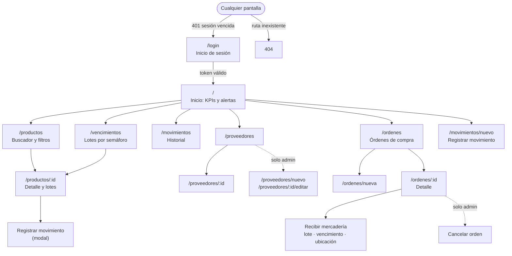

# Checkpoint — TP N.º 2 · Farma-Check

## Conformación

| | |
|---|---|
| Integrantes | {{INTEGRANTES}} |
| Modalidad de trabajo | {{MODALIDAD}} |
| Repositorio back-end | https://github.com/Kano55K/Farma-Check (rama `tp2-integracion`) |
| Repositorio front-end | https://github.com/Kano55K/farma-check-front |

## Proyecto elegido

**Farma-Check**, sistema de control de stock de farmacia desarrollado en el TP 1 con Ruby on Rails 8.1.
Para el TP 2 se separan dos contextos:

- **Back-office (Rails, ya existente)**: administración del catálogo, usuarios y datos maestros.
- **Front-end nuevo (React + Vite + TypeScript)**: interfaz del **usuario final** (empleado de mostrador /
  farmacéutico) para el trabajo diario, que consume la API REST `api/v1`.

## Alcance previsto del TP 2 (casos de uso integrados)

| # | Caso de uso | Actor | Endpoints |
|---|---|---|---|
| CU1 | Iniciar y cerrar sesión, con vencimiento del token | Empleado, admin | `POST /login`, `DELETE /logout`, `GET /profile` |
| CU2 | Ver indicadores y alertas del día | Empleado, admin | `GET /dashboard` |
| CU3 | Buscar productos y ver su stock y lotes | Empleado, admin | `GET /products`, `GET /products/:id` |
| CU4 | Registrar un movimiento de stock sobre un lote (salida, entrada, ajuste, baja por vencimiento) | Empleado, admin | `POST /stock_movements` |
| CU5 | Controlar vencimientos por semáforo | Empleado, admin | `GET /batches` |
| CU6 | Consultar el historial de movimientos | Empleado, admin | `GET /stock_movements` |
| CU7 | Consultar proveedores; alta y edición | Empleado (consulta), admin (alta/edición) | `GET/POST /suppliers`, `GET/PATCH /suppliers/:id` |
| CU8 | Crear una orden de compra con ítems y enviarla | Empleado, admin | `POST /purchase_orders`, `PATCH /purchase_orders/:id/send` |
| CU9 | Recibir la mercadería de una orden (crea lotes y entradas de stock) | Empleado, admin | `POST /purchase_orders/:id/receive` |
| CU10 | Cancelar una orden | Admin | `PATCH /purchase_orders/:id/cancel` |

## Mapa de pantallas y navegación (front-end)

Todas las pantallas salvo `/login` requieren sesión. En pantallas chicas el menú lateral se colapsa en
un botón y las tablas pasan a tarjetas.

## Endpoints de la API

| Método | Ruta | Rol | Estado |
|---|---|---|---|
| POST | `/api/v1/login` | pública | Ajustado (token con vencimiento, formato de error) |
| DELETE | `/api/v1/logout` | cualquiera | Ajustado (ahora exige token válido) |
| GET | `/api/v1/profile` | cualquiera | Ajustado |
| GET | `/api/v1/dashboard` | cualquiera | **Nuevo** |
| GET | `/api/v1/products` | cualquiera | Ajustado (filtros, paginación, sin N+1) |
| GET | `/api/v1/products/:id` | cualquiera | Ajustado |
| GET | `/api/v1/batches` | cualquiera | **Nuevo** (la ruta existía sin controlador) |
| GET | `/api/v1/batches/:id` | cualquiera | **Nuevo** |
| GET | `/api/v1/stock_movements` | cualquiera | Ajustado (filtros, paginación) |
| POST | `/api/v1/stock_movements` | cualquiera | Ajustado (validaciones, transacción, strong params) |
| GET | `/api/v1/suppliers` | cualquiera | **Nuevo** (la ruta existía sin controlador) |
| GET | `/api/v1/suppliers/:id` | cualquiera | **Nuevo** |
| POST | `/api/v1/suppliers` | admin | **Nuevo** |
| PATCH | `/api/v1/suppliers/:id` | admin | **Nuevo** |
| GET | `/api/v1/purchase_orders` | cualquiera | **Nuevo** |
| POST | `/api/v1/purchase_orders` | cualquiera | **Nuevo** |
| GET | `/api/v1/purchase_orders/:id` | cualquiera | **Nuevo** |
| PATCH | `/api/v1/purchase_orders/:id/send` | cualquiera | **Nuevo** |
| PATCH | `/api/v1/purchase_orders/:id/cancel` | admin | **Nuevo** |
| POST | `/api/v1/purchase_orders/:id/receive` | cualquiera | **Nuevo** |

Contrato completo: [`docs/api/README.md`](api/README.md).

## Estado de las observaciones del TP 1

| # | Observación | Estado | Dónde |
|---|---|---|---|
| 1 | Rutas `api/v1/batches` y `api/v1/suppliers` sin controlador | ✔ Resuelta | `app/controllers/api/v1/batches_controller.rb`, `suppliers_controller.rb` |
| 2 | La API heredaba de `ActionController::Base` (`allow_browser` → 406 a curl/Postman) | ✔ Resuelta | `Api::V1::BaseController < ActionController::API` |
| 3 | Sin CORS | ✔ Resuelta | `rack-cors`, `config/initializers/cors.rb`, `FRONTEND_ORIGIN` |
| 4 | `StockMovement` sin validaciones, stock negativo posible | ✔ Resuelta | `app/models/stock_movement.rb` (validaciones + transacción) |
| 5 | README con `"entry"`; enum inválido → 500 | ✔ Resuelta | `enum ... validate: true` → 422; README y contrato con los valores reales |
| 6 | Formato de errores inconsistente | ✔ Resuelta | Formato único `{ error: { code, message, details } }` con `rescue_from` |
| 7 | Sin autorización por rol en la API | ✔ Resuelta | `require_admin!` → 403 (proveedores, cancelar órdenes) |
| 8 | Token sin vencimiento; `logout` sin autenticación | ✔ Resuelta | `api_token_expires_at` (12 h, configurable); logout exige token |
| 9 | `params[...]` sueltos en `stock_movements#create` | ✔ Resuelta | `params.require(:stock_movement).permit(...)` (acepta también cuerpo plano) |
| 10 | N+1 en `products#index`, sin paginación | ✔ Resuelta | `Product.with_active_stock` (una consulta) + `page`/`per_page` |
| 11 | `.ruby-version` (4.0.6) distinto del README (3.3.12) | ✔ Resuelta | `.ruby-version` = 3.3.12 (versión instalada y probada) |
| 12 | Bases SQLite versionadas | ✔ Resuelta | `git rm --cached`, `.gitignore` |
| 13 | Seeds con contraseña real y datos mínimos | ✔ Resuelta | `db/seeds.rb`: datos de demo completos e idempotentes, contraseña `demo1234` |
| — | Búsqueda del back-office con `ILIKE` (no existe en SQLite) | ✔ Resuelta (hallazgo extra) | `ProductsController#index` |
| — | `CheckExpiredBatchesJob` usaba un estado inexistente | ✔ Resuelta (hallazgo extra) | `app/jobs/check_expired_batches_job.rb` |
| — | Movimientos del back-office registrados a nombre de `User.first` | ✔ Resuelta (hallazgo extra) | `StockMovementsController#create` usa el usuario de la sesión |
| — | Borrar un proveedor borraba en cascada sus órdenes | ✔ Resuelta (hallazgo extra) | `dependent: :restrict_with_error` + aviso en el back-office |
| — | Tests heredados rotos (29 de 60 fallaban) | ✔ Resuelta (hallazgo extra) | Sesión en tests, helpers de rutas, fixtures, ejecución en serie en Windows |
